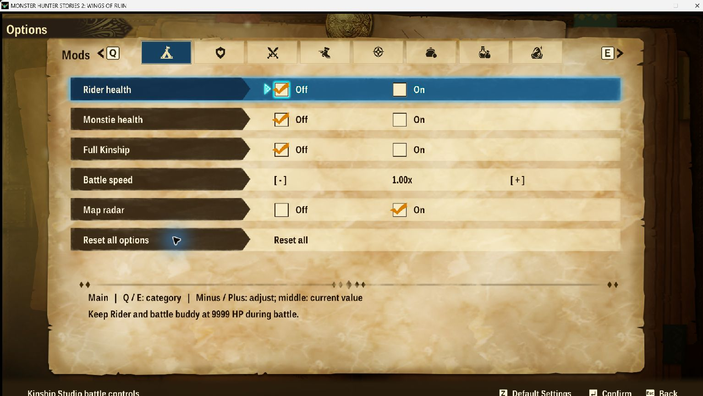
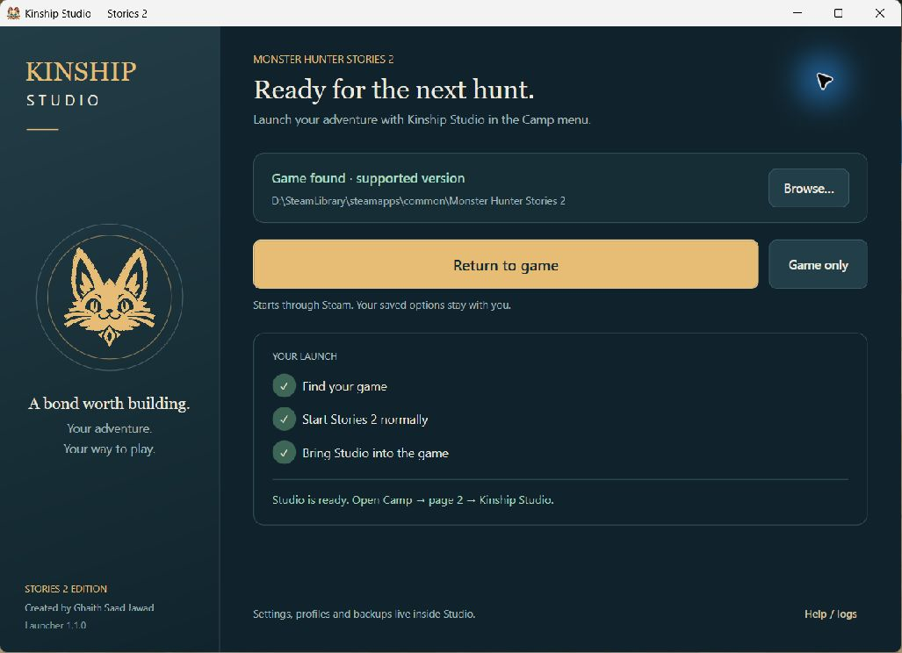
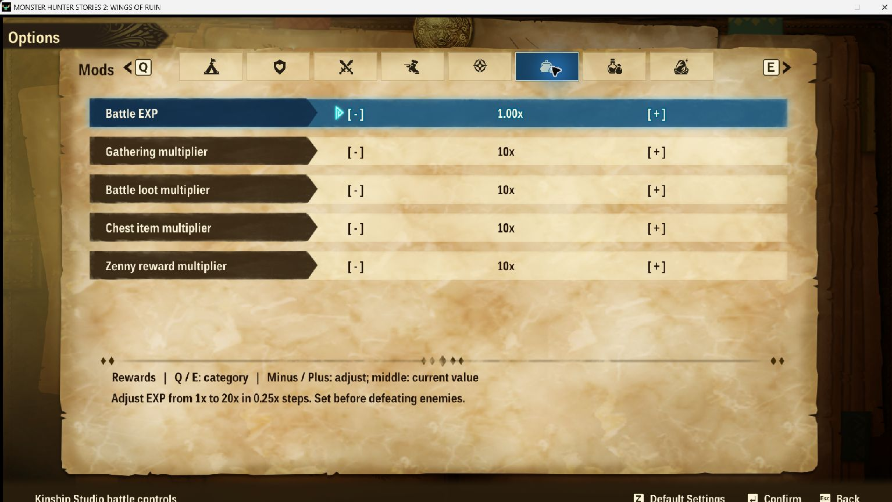

# Kinship Studio — Your hunt. Your pace.

A native **Camp-menu mod for Monster Hunter Stories 2: Wings of Ruin**, with a Windows launcher that finds Steam, starts the game normally and loads Studio automatically.

**Created by Ghaith Saad Jawad.** Free and open source under the MIT license.

[**Download the Windows installer**](https://github.com/Karthus3560/monster-hunter-stories-2-trainer/releases/download/studio-v1.1.0/KinshipStudio-Launcher-1.1.0-Setup.exe) · [**Visit the website**](https://karthus3560.github.io/monster-hunter-stories-2-trainer/) · [Release notes](https://github.com/Karthus3560/monster-hunter-stories-2-trainer/releases/tag/studio-v1.1.0) · [Build from source](native/README.md)

## Install once. Then play.

1. Close Stories 2 and download **KinshipStudio-Launcher-1.1.0-Setup.exe** from the release above.
2. Run Setup, then open **Kinship Studio - Play Stories 2** from your desktop.
3. Choose **Play with Studio**. It finds the Steam installation, launches the game and waits for verified menu readiness. Use Browse if needed.
4. Open **Camp → page 2 → Kinship Studio** in a solo game.

Windows x64 and the supported Steam game build **1.6.1** are required. No Cheat Engine, Python, separate .NET installation or account is needed. The launcher checks the exact executable and refuses unsupported versions.

## Inside Studio

| Tab | Controls |
| --- | --- |
| **Main** | Five shortcuts for everyday controls; Reset all with confirmation. |
| **Survival** | Rider/buddy health, allied Monstie health, party hearts and incoming damage. |
| **Power** | Attack, Kinship, mounted Kinship attack level, battle speed and turn counter. |
| **Movement** | Walking/running, ground riding, flying, swimming and egg-carrying speeds. |
| **Exploration** | Radar, gathering range, faster manual gathering, eligible retreat and Prayer Pot effects. |
| **Rewards** | Separate Battle EXP, gathering, monster loot, ordinary chest items and earned Zenny multipliers. |
| **Inventory** | Ordinary battle-item and crafting-material preservation; settings, five profiles and save backups. |
| **Egg Hunt** | Egg-quality and den-rarity presets; prevention of empty solo egg pulls. |

The game’s fonts, navigation and controller flow are retained, with a custom Camp emblem and centered category tabs. Controls start at Off/Normal on a fresh installation. **Restore last settings** can bring your saved choices back on the next launch.

## Settings and backups

Profiles and backup screens are under **Inventory**. Save restores are queued until the game exits, verified, and preceded by a safety backup. Personal data lives in `%LOCALAPPDATA%\KinshipStudioNative\data`; verified session files live in `%USERPROFILE%\Kinship Studio Runtime`.

Close the game and launcher before updating or uninstalling. Rerun Setup to update/repair, or remove the launcher through Windows Installed apps. Settings, profiles and backups are preserved.

## What to expect

- Use this mod in single player. The exact supported executable SHA-256 is `AC73BBA1019F09DE83CA8466C4856B3937E9D63972F5FBCA2BCBC670437B7DA9`.
- Dens and eggs use the selected presets when newly generated. Regenerate the area for new dens. Existing/carried eggs stay unchanged; rainbow glow does not guarantee a Rainbow Gene. Story and unlock restrictions still apply.
- Crafting preservation still requires the ingredients and charges Zenny. Battle-item preservation does not cover all field/camp items or nutriments.
- The launcher can attach to an already running supported game. It refuses duplicate or partial sessions; if a loading attempt fails, restart the game before retrying.
- This release is **unsigned**. Download from this repository's Releases; `SHA256SUMS.txt` is supplied for verification. The website does not require an account or collect telemetry.

## The older desktop trainer

The previous **v3.5.2 desktop trainer and offline Egg & Gene Studio** are a separate application. They remain in [earlier releases](https://github.com/Karthus3560/monster-hunter-stories-2-trainer/releases/tag/v3.5.2), with a [desktop guide](docs/DESKTOP-TRAINER.md). Don’t run the two apps together. Advanced desktop editors are not part of this native release. Archive changes previously made by the old tool remain separate and must be managed by that tool.

## Source and validation

The current launcher, native modules, clean assets, installer and Windows build script are in [`native/`](native/README.md). Historical desktop source stays at the repository root. The native release passed gameplay and menu checks, launcher checks, actual installer install/update/uninstall fixtures, and a real Steam launch with both modules. The developer's live in-game test confirmed successful startup; this does not establish every preset or edge case.

[Report an issue](https://github.com/Karthus3560/monster-hunter-stories-2-trainer/issues) with your game version, launcher message and reproduction steps. Do not attach saves, tokens or private logs without reviewing their contents.

This is an independent fan project, not affiliated with or endorsed by Capcom. Monster Hunter and game imagery belong to their respective owners. See [LICENSE](LICENSE) and [THIRD-PARTY-NOTICES.md](THIRD-PARTY-NOTICES.md).
