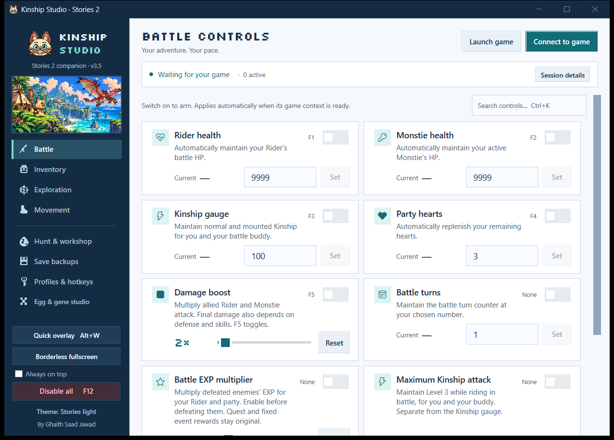
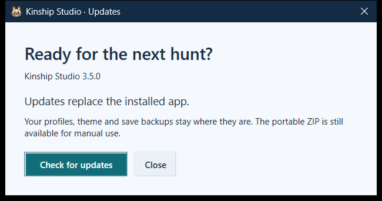
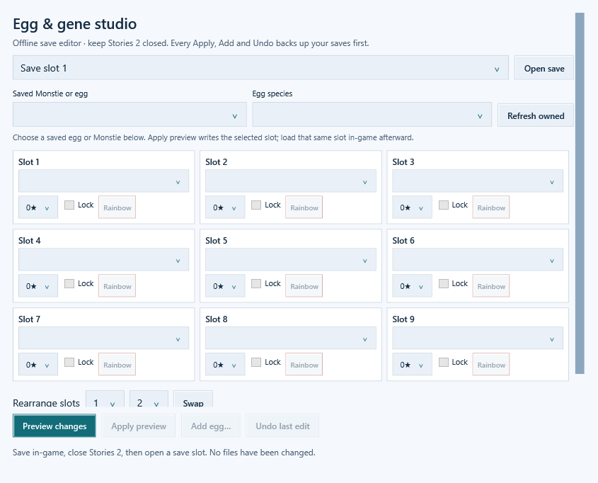
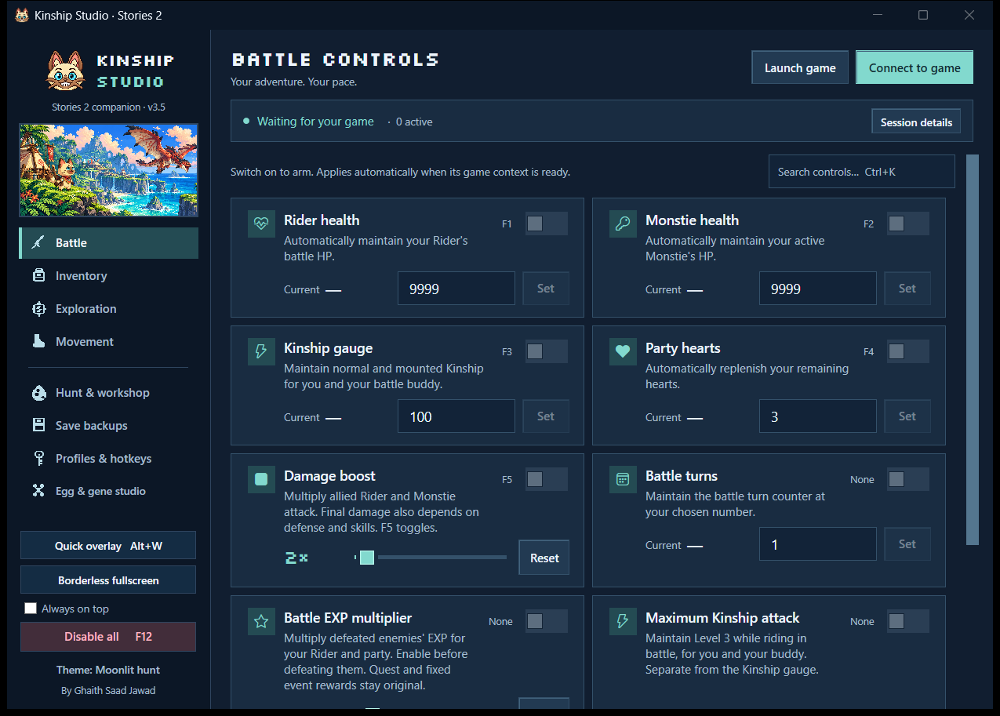
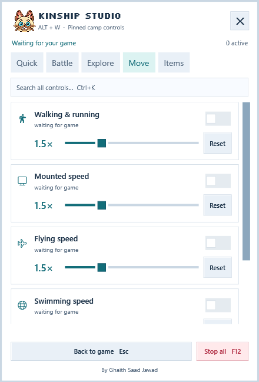

<p align="center"></p>

# Kinship Studio — Monster Hunter Stories 2 Trainer & Save Editor

<p align="center"><strong>Your hunt. Your pace. Your perfect Monstie.</strong><br />A free, open-source Windows trainer for <em>Monster Hunter Stories 2: Wings of Ruin</em>, with an in-game quick panel and an offline Egg & Gene Studio.<br /><strong>Created by Ghaith Saad Jawad.</strong></p>

<p align="center">
<a href="https://github.com/Karthus3560/monster-hunter-stories-2-trainer/releases/latest"></a>
<a href="LICENSE"></a>


<a href="https://github.com/Karthus3560/monster-hunter-stories-2-trainer/actions/workflows/build.yml"></a>
</p>

<p align="center"><a href="https://github.com/Karthus3560/monster-hunter-stories-2-trainer/releases/latest"><strong>Download for Windows</strong></a> &nbsp; · &nbsp; <a href="https://karthus3560.github.io/monster-hunter-stories-2-trainer/">Project website</a> &nbsp; · &nbsp; <a href="#quick-start">Quick start</a> &nbsp; · &nbsp; <a href="#egg--gene-studio">Egg & Gene Studio</a> &nbsp; · &nbsp; <a href="CONTRIBUTING.md">Build from source</a></p>



## Less grinding. More adventure.

Kinship Studio brings **31 live gameplay controls**, rainbow egg and den settings, verified save backups, and an offline egg/gene editor into one native desktop app. Steam detection and automatic connection replace manual address searches. **No Cheat Engine installation or subscription is required.**

Open the **Alt+W** quick panel while playing, tune movement and rewards, then return to the hunt. When the game is closed, create unhatched eggs—even in an empty carton—and arrange genes in a visual 3 × 3 board.

| Play your way | What you can do |
| --- | --- |
| **Make battles yours** | Rider and Monstie health, persistent Kinship, party hearts, damage multiplier, damage-taken slider, enemy HP, turn count, maximum Kinship attack level and battle fast-forward. |
| **Make every trip count** | 100% retreat for eligible monsters, loaded map markers, 4× gathering range, faster manual gathering, auto-collect and selectable Prayer Pot effects. |
| **Move at your pace** | Independent walking/running, mounted, flying, swimming and egg-carrying speed sliders, with Reset controls. |
| **Skip the repetitive grind** | Battle EXP multiplier, 2×/5×/10× loot, Zenny, Bottle Caps, owned item/material stacks, and ordinary battle/field item preservation. |
| **Make the nest shine** | Rainbow egg quality, rare-den settings, no empty egg pulls, plus free crafting/forging and level-one gene requirements. |
| **Build your Monstie** | Add unhatched eggs, choose egg species, copy eggs, edit genes/stars/locks, place Rainbow Genes and rearrange the gene board. |
| **Keep it comfortable** | Alt+W quick panel, F12 stop-all, saved profiles, editable hotkeys, light/night themes and compact window layouts. |

**Single-player Steam build:** inspected against **1.6.1.0**. Retreat rules, story restrictions and unlocked riding abilities still matter. Incompatible layouts are refused rather than guessed. See [compatibility and feature details](docs/COMPATIBILITY.md).

## Quick start

1. Download **`KinshipStudio-v3.5.0-Setup.exe`** from [Releases](https://github.com/Karthus3560/monster-hunter-stories-2-trainer/releases/latest).
2. Run Setup once. It installs or upgrades the existing **Kinship Studio** app and desktop shortcut. It keeps one installation across versions; administrator access is not needed. The internal executable remains `RidersToolkit.exe`.
3. Start Stories 2 from Steam or use **Launch game**. Load a solo save; the trainer connects automatically.
4. Switch on the controls you want. Open quick controls with **Alt+W**. **F12** stops live maintenance controls.

The Windows release is self-contained: a separate .NET runtime is not needed. **Profiles & hotkeys → Check for updates** downloads a verified installer and offers **Restart & update**. Profiles, theme and backups are preserved. The portable ZIP is also available for manual use.

**Code signing:** the release is still unsigned. Updates work independently of signing. A publicly trusted publisher signature requires an identity-validated certificate or approved service; self-signing would not make other PCs trust it. Read [updates and code signing](docs/UPDATES-AND-SIGNING.md). Building the source requires the .NET 10 SDK.



For the overlay, use **Windowed**, or Windowed plus **Borderless fullscreen** in the trainer. **True exclusive fullscreen is not supported.** Alt+W closes the panel; its close button also returns to the game. Esc closes it while the panel has keyboard focus.

### Rainbow eggs and rare dens

With Stories 2 closed, open **Hunt & workshop**, choose a preset, and apply it before launching. These settings change generation tables and affect **freshly generated** eggs/dens. The original archive and saves are backed up first. **Restore original game data** reverses these table changes; F12 stops memory controls but does not uninstall table settings.

### Egg & Gene Studio

With the game **closed**:

1. Open **Egg & gene studio**, choose a manual slot, then **Open save**.
2. Choose a saved Monstie/egg to edit, or **Add egg… → New egg** to start from an empty carton.
3. Preview the changes. Apply/Add writes the selected save only after a fresh verified backup.
4. Launch the game and load that same manual slot.

The editor handles manual slots **1–3**, preserves the save's existing encryption identity, updates checksums, verifies re-encryption and replaces the file atomically. **Every Apply, Add and Undo creates a fresh verified backup.** Concurrent file changes and a running game block writes. Undo requires the opened save to still match the last edit. Autosave/system files are not edited by Egg Studio. New eggs start with normal quality and species starter genes; the studio's Rainbow Gene button and the hunt's rainbow egg-quality preset are separate features.



## Built for the way you actually play

<table><tr><td width="56%"><strong>Moonlit hunt</strong><br /></td><td width="44%"><strong>Quick controls · Alt+W</strong><br /></td></tr></table>

The UI pairs a readable white workspace or navy night theme with original pixel artwork, a pixel Navirou mascot, and licensed Silkscreen display typography. Standard minimize/maximize/close buttons, desktop fitting, two-column/one-column control layouts and keyboard focus remain available. Your theme choice is remembered.

## Validation & transparency

- **110 engine checks + 123 interface checks + 11 installer checks** passed on the author's supported installation for v3.5.0. The author has also confirmed gameplay operation; that is one tested setup, not a claim of universal compatibility.
- The public Windows CI workflow builds the app and runs **105 portable engine checks**. Five installed-archive checks are explicitly skipped there; copyrighted game archives are not supplied to CI. A hosted CI pass is not claimed for this release: the first hosted job did not start. Check [Actions](https://github.com/Karthus3560/monster-hunter-stories-2-trainer/actions) for current status.
- UI checks cover the real font/assets, theme persistence, compact/wide card placement, editor opening, backup gates, overlay focus behavior and native test windows. They do not prove visibility over an exclusive DirectX surface.
- This repository ships source and original UI assets, **not game archives, save files, downloaded trainers or private process dumps**.

[Testing guide](docs/TESTING.md) · [Source architecture](docs/ARCHITECTURE.md) · [Third-party notices](THIRD-PARTY-NOTICES.md) · [Report an issue](https://github.com/Karthus3560/monster-hunter-stories-2-trainer/issues/new/choose)

## Build it yourself

On Windows with the **.NET 10 SDK** and PowerShell 7:

```powershell
git clone https://github.com/Karthus3560/monster-hunter-stories-2-trainer.git
cd monster-hunter-stories-2-trainer
pwsh ./scripts/build.ps1
```

The script builds a self-contained Windows x64 release, runs portable checks, and writes a ZIP and SHA-256 checksum under `artifacts/`. Add `-Installer` with Inno Setup 6.7+ installed to produce the upgrade-aware Setup executable. `pwsh ./scripts/test-installer.ps1` checks install/upgrade/reinstall/downgrade behavior using an isolated identity and folder. For the full installed-game and interface checks, use `pwsh ./scripts/build.ps1 -FullTests -UiTests` with a supported local installation and the game closed.

## Credits & license

**Created by Ghaith Saad Jawad.** Source code is available under the [MIT license](LICENSE). Existing third-party components keep their own licenses; see [THIRD-PARTY-NOTICES.md](THIRD-PARTY-NOTICES.md).

Monster Hunter, Monster Hunter Stories 2, Rathalos and Navirou belong to Capcom. This is an **unofficial community project**, with no Capcom affiliation or endorsement. Research references and the Silkscreen font license are recorded in the notices. The MIT license does not grant ownership of Capcom's characters or trademarks.

If this makes your next hunt better, a GitHub star helps other Riders find it. Contributions, bug reports and compatibility notes are welcome.
